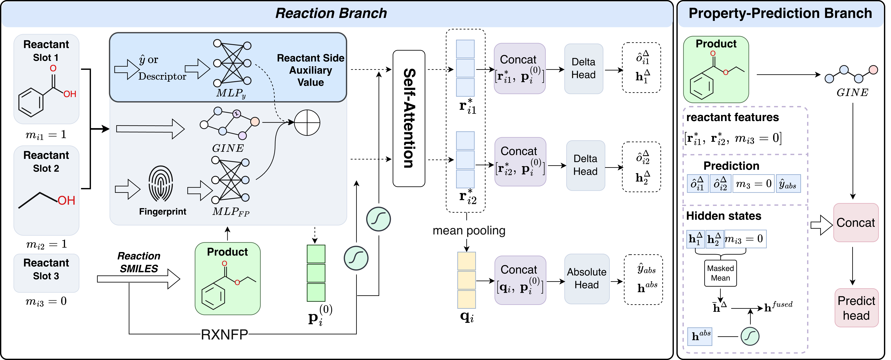

# MolREA

<p align="center">
  
</p>

## About dataset and backbone
Because the size of dataset and backbone excesses the limitation, so I have uploaded them in Google Drive, Please download them accounding the URL I left in readme file. 

## Use
```python
python main.py --dataset xxx
```
Run specifical dataset. Process: load backbone.pt -> finetune -> predict
